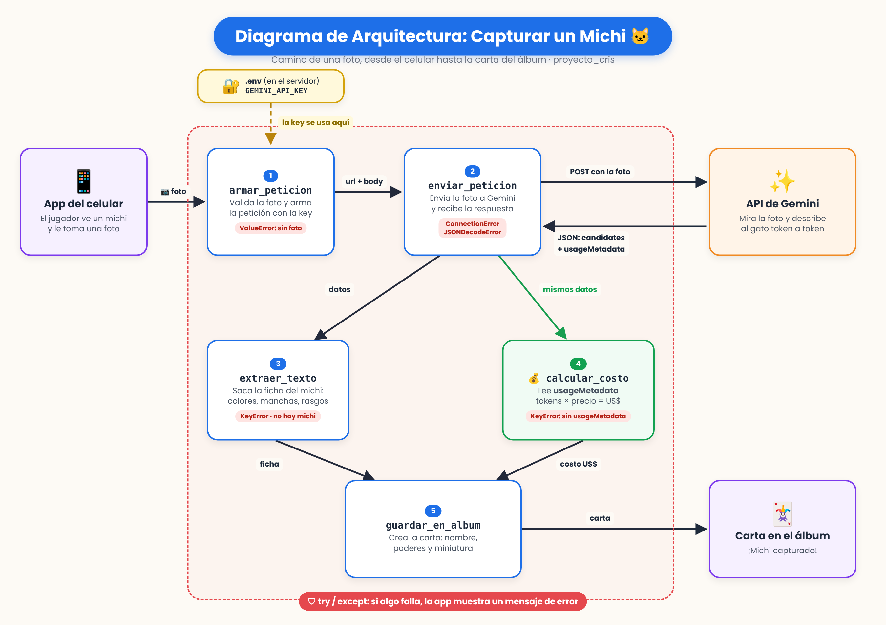

# Decisión de arquitectura: elección de modelo

Fecha de la comparación: 20 de octubre de 2026

## Modelo elegido

**Gemini 3.1 Flash-Lite** (`gemini-3.1-flash-lite`), de Google.

## Diagrama de arquitectura

El diagrama de la miniaplicación (app de michis) está en el Bloque 8:

  

La decisión de este documento corresponde al componente "modelo generativo" de ese diagrama.

## Comparación de candidatos

Pregunta de prueba para latencia y costo (la misma en todas las repeticiones):
"Describe en una frase a un gato callejero naranjo atigrado con una mancha blanca en el pecho."

| Criterio | Gemini 3.8 Flash | Gemini 3.1 Flash-Lite |
|---|---|---|
| Costo por 1000 tokens de entrada | 0,00075 USD | 0,00025 USD |
| Costo por 1000 tokens de salida | 0,00375 USD | 0,0015 USD |
| Latencia promedio observada | 44,46 segundos | 9,09 segundos |
| Costo real de la petición de prueba | 0,000156 USD | 0,0000101 USD |
| Calidad de respuesta para mi caso | Muy buena: descripciones con más estilo, pero se extiende de más cuando la pregunta es abierta | Buena: cumple lo pedido en las 3 preguntas de prueba; también se extiende en la pregunta abierta |
| Límite del plan gratuito | 20 peticiones al día (lo alcancé durante las pruebas) | No lo alcancé durante las pruebas |

Notas sobre las mediciones:
- Precios tomados de la página oficial: https://ai.google.dev/gemini-api/docs/pricing
- Cada modelo se midió con 4 repeticiones y una pausa entre ellas. Los intentos que fallaron por saturación del proveedor (alta demanda o límite de uso) quedaron fuera del promedio.
- Calidad evaluada con 3 preguntas representativas de la app: describir un gato atigrado, inventar nombre y poder para un gato negro, y describir un gato tricolor con un ojo de cada color.

Proyección a 50.000 peticiones al mes, con el costo real de la petición de prueba:
- Gemini 3.8 Flash: 0,000156 × 50.000 = **7,80 USD al mes**
- Gemini 3.1 Flash-Lite: 0,0000101 × 50.000 = **0,51 USD al mes**

## Justificación

Elegí Gemini 3.1 Flash-Lite porque mi miniaplicación genera cartas de colección de gatos: necesita una descripción corta, un nombre y un poder, y para eso "cubrir lo esencial" es suficiente.

El criterio que más pesó fue la **latencia**. La persona saca la foto al gato y espera su carta en el momento: esperar 9 segundos es aceptable, pero 44 segundos no lo es. En segundo lugar pesó el **costo**: Flash-Lite fue unas 15 veces más barato en la petición de prueba, una diferencia que se vuelve importante si la app crece.

En **calidad**, Flash-Lite respondió correctamente las 3 preguntas de prueba. 3.8 Flash escribe con algo más de estilo, pero esa diferencia no es un requisito real de la app.

## Alternativa descartada y por qué

Descarté **Gemini 3.8 Flash**. Sus respuestas tienen más detalle y estilo, pero en mis pruebas fue unas 5 veces más lento (44,46 s contra 9,09 s) y unas 15 veces más caro por petición. Además, en el plan gratuito permite solo 20 peticiones al día, límite que alcancé solo haciendo pruebas, y su precio actual es de lanzamiento: según el proveedor, se duplica desde el 1 de enero de 2027. Para una app donde el usuario espera su carta en el momento, el detalle adicional no justifica ese tiempo de espera ni ese costo.
